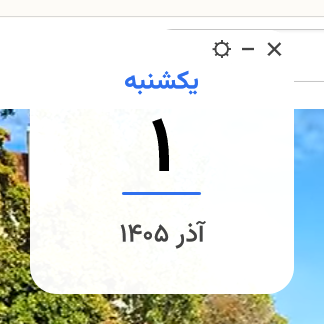
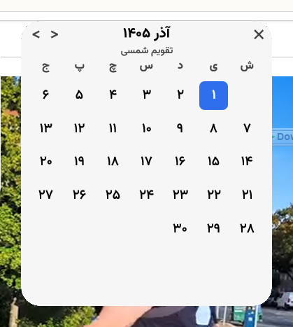
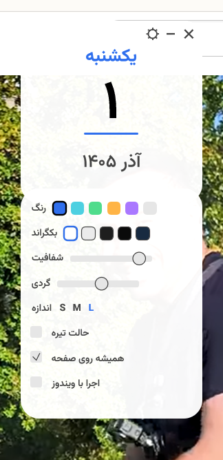

# Shamsi Widget

A borderless, semi-transparent **Persian (Jalali) calendar widget** for Windows, written in **Rust + egui/eframe**.
Tray-only, no titlebar, no chrome — a glass day-card on your desktop plus a full monthly Jalali calendar.

Persian text is shaped by **Windows GDI** (embedded Vazirmatn) and drawn as supersampled textures, because egui has no bidi/shaping.

| Day card | Monthly calendar | Settings |
|:--:|:--:|:--:|
|  |  |  |

## Features

- **Day card** — weekday, big day number, month + year, all in Persian digits
- **Monthly calendar** — RTL grid, weekday header (ش ی د س چ پ ج), today highlighted, `<` `>` month navigation
- **Borderless & transparent** — adjustable corner radius, opacity and background colour, live
- **6 accents** — blue, cyan, green, amber, violet, white
- **3 sizes**, dark mode, always-on-top, optional run-at-startup
- **Tray only** — left-click the tray icon to show/hide, right-click for the menu; single instance
- **Smooth Persian text** — GDI glyphs rendered at 3× and box-downscaled (`SS=3`, gamma 0.88) then snapped to the physical pixel grid, so the text stays crisp instead of pixelated
- **Settings** in `%APPDATA%\ShamsiWidget\settings.ini` (the only registry entry is the optional autostart flag)

## Download

**Installer (recommended)** — `ShamsiWidget-Setup-1.0.0.exe` from [Releases](../../releases): per-user install
(no administrator rights, no UAC prompt) into `%LOCALAPPDATA%\Programs\Shamsi Widget`, with optional desktop
shortcut and “run at Windows startup”. Uninstall from *Apps & features* or the Start Menu — your colours and
position in `%APPDATA%\ShamsiWidget` are kept, so a reinstall looks the same. The wizard is bilingual:
**فارسی (default, RTL)** and English.

**Portable** — `shamsi-widget-v1.0.0-win64.zip` from [Releases](../../releases) contains the exe and the tray icon.
Unzip anywhere, run `shamsi_widget.exe`; the icon lives in the notification area (right side of the taskbar).

Neither build has runtime dependencies; the first run may show “Windows protected your PC” because the exe is
not code-signed → *More info* → *Run anyway*. That warning is expected and only appears once.

## Build

```bash
cargo build --release --offline   # x86_64-pc-windows-gnu toolchain
```

- egui/eframe pinned to `=0.31.1`
- `fonts/*.ttf` (Vazirmatn medium + bold) are **embedded at compile time**, nothing to install at runtime
- `widget.ico` must sit next to the exe (the tray icon is loaded from disk)

### Installer

`installer/shamsi-widget.nsi` is a plain **NSIS 3** script (Unicode, per-user, LZMA-solid). Build it with the
release exe, the icon and the README in one folder:

```bash
makensis /DSRCDIR=<folder with shamsi_widget.exe + widget.ico + README.md> installer/shamsi-widget.nsi
# -> installer/ShamsiWidget-Setup-1.0.0.exe
```

## فارسی

ویجت **تقویم شمسی** برای ویندوز: بدون حاشیه، نیمه‌شفاف و شیشه‌ای، نوشته‌شده با **Rust + egui/eframe**.
فقط در سینی سیستم (کنار ساعت) آیکون دارد — نه تیتربار، نه پنجرهٔ اضافه.

| کارت روز | تقویم ماهانه | تنظیمات |
|:--:|:--:|:--:|
|  |  |  |

**امکانات**

- کارت روز: نام روز هفته، عدد بزرگ روز، ماه و سال — همه با اعداد فارسی
- پنجرهٔ تقویم ماهانه: چیدمان راست‌به‌چپ، سرستون روزهای هفته، امروز مشخص، جابه‌جایی ماه با `<` و `>`
- بدون حاشیه و شفاف: گردی گوشه‌ها، میزان شفافیت و رنگ پس‌زمینه قابل تنظیم و بی‌درنگ
- ۶ رنگ لهجه (آبی، فیروزه‌ای، سبز، نارنجی، بنفش، سفید)، ۳ اندازه، حالت تیره، همیشه روی صفحه، اجرا با ویندوز
- فقط آیکون سینی: کلیک چپ = نمایش/مخفی، کلیک راست = منو؛ فقط یک نمونه اجرا می‌شود
- **متن فارسی نرم و واضح**: گلیف‌ها با GDI سه‌برابر رندر و بعد کوچک می‌شوند (سوپرسمپل) و روی گرید پیکسل واقعی اسنپ می‌شوند، برای همین پیکسلی/دندانه‌دار نیست
- تنظیمات در `%APPDATA%\ShamsiWidget\settings.ini` ذخیره می‌شود

**دانلود**

۱) **اینستالر (پیشنهادی)**: فایل `ShamsiWidget-Setup-1.0.0.exe` از بخش [Releases](../../releases) — نصب داخل حساب خودتان،
بدون نیاز به دسترسی ادمین و بدون پنجرهٔ UAC. داخل `%LOCALAPPDATA%\Programs\Shamsi Widget` نصب می‌شود و
میان‌بر دسکتاپ و «اجرا با ویندوز» را می‌پرسد. حذف نصب از *Apps & features* یا منوی استارت انجام می‌شود و
تنظیمات شما در `%APPDATA%\ShamsiWidget` پاک نمی‌شود؛ پس بعد از نصب دوباره، همان رنگ و همان جای قبلی برمی‌گردد.
زبان ویزارد: **فارسی** (پیش‌فرض، راست‌به‌چپ) و انگلیسی.

۲) **نسخهٔ قابل‌حمل**: فایل `shamsi-widget-v1.0.0-win64.zip` (شامل exe و آیکون) — از حالت فشرده باز کنید و اجرا کنید.

بار اول ویندوز ممکن است هشدار «Windows protected your PC» بدهد (چون فایل امضای دیجیتال ندارد) →
*More info* و بعد *Run anyway*. هیچ وابستگی زمان‌اجرا لازم نیست.

## License

MIT
